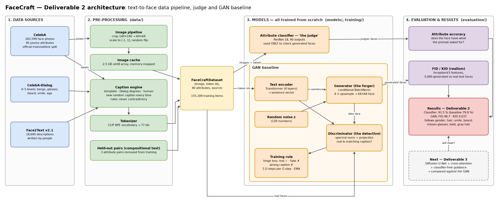
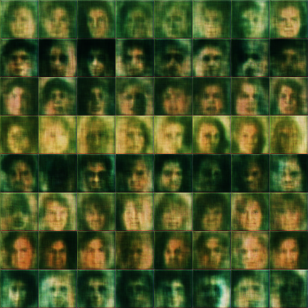
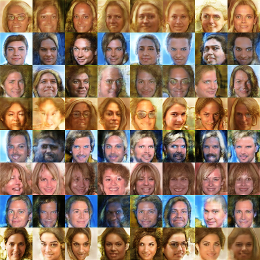

# FaceCraft

**Text-to-face generation with models trained entirely from scratch.**
Type *"a smiling young woman with blond hair"* → get a matching 64×64 face.

CS495 Deep Learning · Fall 2026 · MedTech – South Mediterranean University · Theme: Generative AI & Intelligent Language Systems
Team: **Oussama Sfar · Ines Turki · Feriel Charrad · Yasmine Jedidi**



## What's inside

| Component | What it does | Status |
|---|---|---|
| **Data pipeline** | CelebA (202,599 faces, 40 attributes) + CelebA-Dialog (fine-grained levels) + Face2Text (18,690 human descriptions) → 64×64 cache, captions from 3 sources, CLIP-BPE tokens | ✅ |
| **Attribute classifier** ("the judge") | ResNet-18 trained from scratch; checks whether a generated face has what the prompt asked for | ✅ 91.5 % test acc. |
| **GAN baseline** | Transformer text encoder + conditional-BatchNorm generator + spectral-norm projection discriminator, hinge loss with mismatched-caption term | ✅ FID 48.7 |
| **Diffusion model** (core) | U-Net denoiser with cross-attention to text, classifier-free guidance, DDIM sampling | 🚧 Deliverable 3 |
| **Gradio demo** | Prompt box, guidance slider, diffusion vs. GAN side by side | 🚧 Deliverable 3 |

## Results so far (Deliverable 2)

| Model | Metric | Value |
|---|---|---|
| Attribute classifier | Mean test accuracy over 40 attributes | **91.5 %** (majority baseline 79.9 %) |
| | Eyeglasses / Hat / Bald / Male | 99.7 % / 99.1 % / 99.0 % / 98.3 % |
| GAN baseline (10k G-steps) | FID / KID (5,000 test captions) | **48.7** / 0.037 |

GAN samples (one row per prompt, same seeds) — step 1,000 vs. step 10,000:

<p align="center">
   &nbsp;
  
</p>

Prompts (rows): smiling young woman with blond hair · young man with black hair and glasses · older man with gray hair and a beard ·
woman with wavy brown hair wearing lipstick · young man with a goatee and a mustache · smiling woman with bangs and earrings ·
bald older man · young woman with straight black hair and heavy makeup.

The GAN follows gender, hair colour, bangs, smiles and facial hair, but misses rare attributes (glasses, bald, gray hair) and
lacks variety — the gaps the diffusion model is meant to close.

📓 Full analysis: [`notebooks/01_data_and_preprocessing_executed.ipynb`](notebooks/01_data_and_preprocessing_executed.ipynb)

## Quick start

```bash
git clone https://github.com/SfarOussama9/FaceCraft.git && cd FaceCraft
python -m venv .venv && .venv\Scripts\activate            # Windows (Linux/macOS: source .venv/bin/activate)
pip install torch==2.6.0 torchvision==0.21.0 --index-url https://download.pytorch.org/whl/cu124
pip install -r requirements.txt
pytest -q                                                  # 55 tests, CPU, ~1 min
```

### Data
Keep datasets **outside** cloud-synced folders (OneDrive / Dropbox).
```bash
python scripts/download_data.py --out C:/datasets/facecraft   # Face2Text auto; prints CelebA / Dialog instructions
```
* **CelebA**: [Kaggle `jessicali9530/celeba-dataset`](https://www.kaggle.com/datasets/jessicali9530/celeba-dataset) → unzip into `<out>/celeba`
* **CelebA-Dialog** labels: [`combined_annotation.txt`](https://drive.google.com/file/d/1wZcVEjJ5LwP1Ciuc3j_RFw9Vcusj4UEU/view) → `<out>/dialog/`
* **Face2Text v2.1**: [Zenodo 10973388](https://zenodo.org/records/10973388) (downloaded by the script)

Edit the paths in `configs/data.yaml`, then build the 64×64 cache (~2 min, 2.5 GB):
```bash
python -m data.preprocess --config configs/data.yaml
```

### Train & generate
```bash
python -m training.train_classifier --config configs/classifier.yaml   # ~1 h on an RTX 4070
python -m training.train_gan        --config configs/gan.yaml          # ~2.5 h; resumes automatically
python scripts/generate.py "a smiling young woman with blond hair" --n 8 --seed 0
```
Every script saves `outputs/<run>/last.pt` and **resumes** if restarted. Running on Kaggle: see [`docs/KAGGLE.md`](docs/KAGGLE.md).

## Repository layout

```
data/        loaders (CelebA, Face2Text, Dialog), caption engine, held-out pairs, preprocessing/cache, Dataset
models/      attribute classifier, Transformer text encoder, GAN
training/    training scripts + shared helpers (checkpoint/resume, EMA, AMP)
evaluation/  FID / KID
scripts/     data download, prompt -> faces, notebook generator
configs/     every hyperparameter, one YAML per experiment
notebooks/   Deliverable 2 notebook (source + executed + HTML)
tests/       55 pytest tests on synthetic data (no dataset needed)
docs/        design document, plans, Kaggle guide, diagrams
```

## Design notes
* **From scratch.** The classifier, text encoder, generator and discriminator are trained from random initialisation.
  Pretrained parts are measurement-only (InceptionV3 inside FID) or a single ablation (CLIP text encoder); the CLIP tokenizer
  is just a vocabulary table.
* **Truthful captions.** 40 yes/no labels become varied sentences, but never contradictory ones (no "bald with bangs",
  one hair colour max, no "full beard" for stubble).
* **Compositional test.** Three attribute pairs (Sideburns+Smiling, High_Cheekbones+Pale_Skin, Blond_Hair+Narrow_Eyes) are
  removed from all generator training data to test combining concepts never seen together.
* **GAN stability.** One discriminator step per generator step made the discriminator blind to images within ~50 steps;
  the SN-GAN recipe (5 D-steps per G-step) fixed it — see `tests/test_gan.py`.

## Datasets & ethics
CelebA, CelebA-Dialog and Face2Text are used under their **non-commercial research** licenses; no dataset files are
redistributed here. CelebA is skewed toward young, light-skinned celebrities and generated faces inherit this bias, which we
measure and report. All generated faces are synthetic; identity prompts (celebrity names) are not supported.

## References
Liu et al., *Deep Learning Face Attributes in the Wild*, ICCV 2015 · Jiang et al., *Talk-to-Edit*, ICCV 2021 ·
Tanti et al., *Face2Text revisited*, LREC-W 2022 · Reed et al., *Generative Adversarial Text to Image Synthesis*, ICML 2016 ·
Miyato et al., *Spectral Normalization for GANs*, ICLR 2018 · Miyato & Koyama, *cGANs with Projection Discriminator*, ICLR 2018 ·
Ho et al., *DDPM*, NeurIPS 2020 · Ho & Salimans, *Classifier-Free Guidance*, 2021 · Heusel et al., *FID*, NeurIPS 2017.
